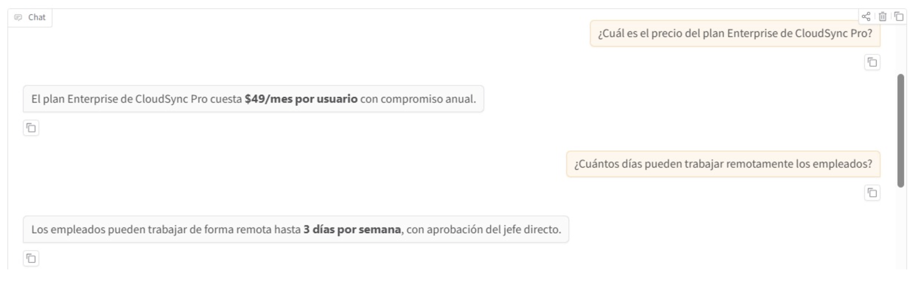
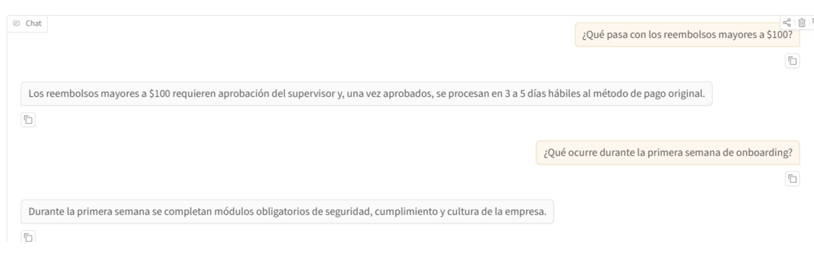
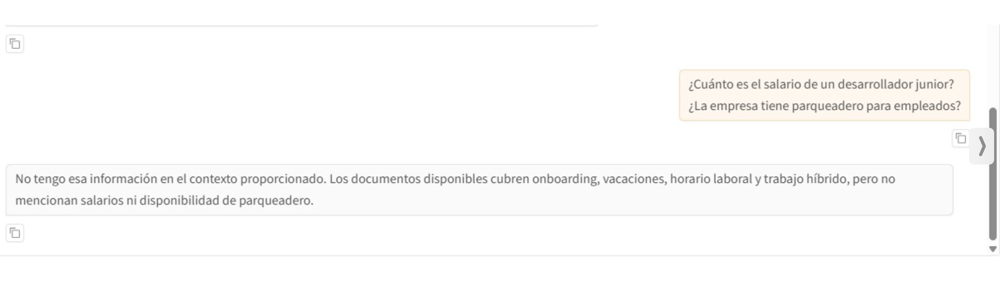
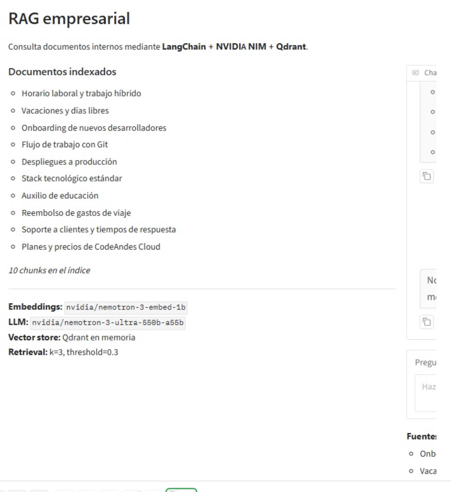
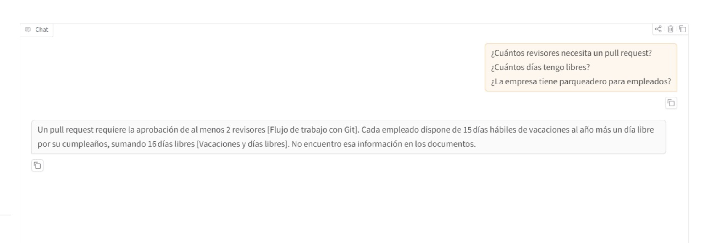
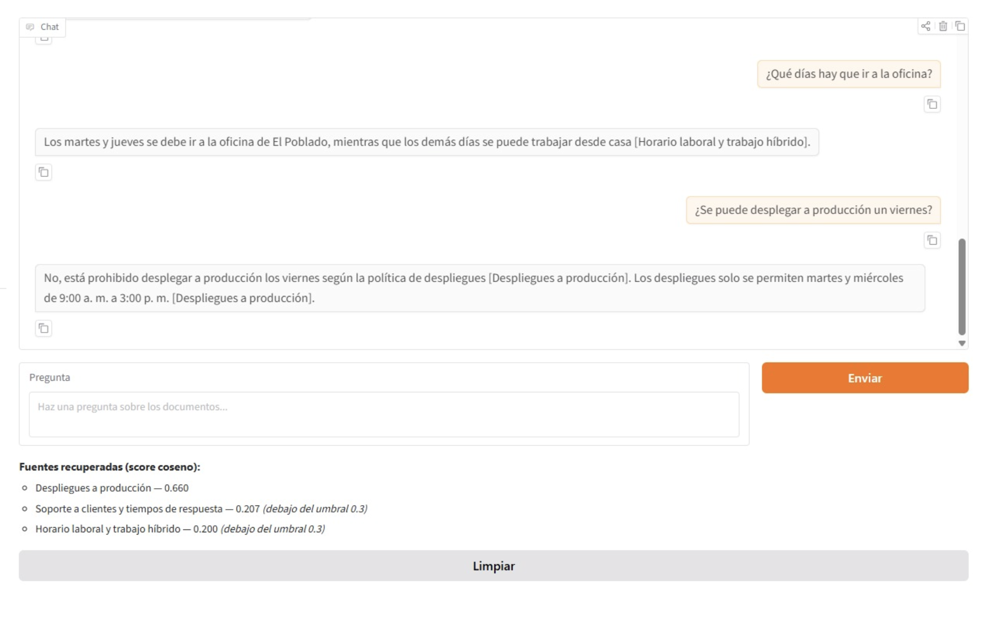

# Respuestas del workshop RAG
Escribe aquí tus respuestas con tus propias palabras. Pega tablas, resultados y enlaces a las capturas de `evidencias/`.

---

# Bloque 0 · Teoría

## T1 · Cuántos nodos viven en cada capa

_Evidencia:_


_Mi respuesta / análisis:_

**1. Cálculo a mano ($M = 16$ y $N = 1,000,000$ vectores)**

Dado que $m_L \approx \frac{1}{\ln(M)}$, la probabilidad de que un vector alcance al menos la capa $k$ es $P(l \ge k) = M^{-k}$. Por lo tanto, el número esperado de nodos en cada capa es $E[N_{\ge k}] = \frac{N}{M^k}$:

- *Capa $\ge 1$:* $\frac{1,000,000}{16^1} = \frac{1,000,000}{16} = \mathbf{62,500\text{ nodos}}$ ($6.25\%$)
- *Capa $\ge 2$:* $\frac{1,000,000}{16^2} = \frac{1,000,000}{256} = 3,906.25 \approx \mathbf{3,906\text{ nodos}}$ ($0.39\%$)
- *Capa $\ge 3$:* $\frac{1,000,000}{16^3} = \frac{1,000,000}{4,096} = 244.14 \approx \mathbf{244\text{ nodos}}$ ($0.024\%$)

**2. Simulación en Python y comparación con el valor teórico**

Código utilizado:
python
import numpy as np

M = 16
mL = 1 / np.log(M)
N = 1_000_000
rng = np.random.default_rng(0)
l = np.floor(-np.log(1 - rng.random(N)) * mL).astype(int)

for k in range(1, 4):
    print(f"capa >= {k}: simulado={(l >= k).sum():>7,}  teórico={N / M**k:>9,.0f}")


Salida obtenida:
text
capa >= 1: simulado= 62,675  teórico=   62,500
capa >= 2: simulado=  4,005  teórico=    3,906
capa >= 3: simulado=    270  teórico=      244


Comparación:Los resultados simulados coinciden muy de cerca con los valores teóricos esperados ($62,675$ vs. $62,500$ en capa $\ge 1$; $4,005$ vs. $3,906$ en capa $\ge 2$; y $270$ vs. $244$ en capa $\ge 3$). Las pequeñas diferencias se deben a la varianza natural del muestreo aleatorio con $N = 1,000,000$, confirmando que la distribución exponencial reduce la cantidad de nodos a razón de un factor de $\frac{1}{16}$ por cada capa que se sube.

**3. ¿Por qué es bueno para la velocidad de búsqueda que haya pocos hubs en las capas altas?**

Tener muy pocos nodos (hubs) en las capas superiores permite que la búsqueda greedy inicial (con ef = 1) avance con enlaces de largo alcance ("autopistas") evaluando distancias contra apenas unas decenas o cientos de vectores en lugar de explorar un millón de nodos. De esta manera, el algoritmo se aproxima rápidamente a la región correcta del espacio vectorial en tiempo logarítmico $O(\log N)$ antes de realizar la búsqueda exhaustiva en la capa base (capa 0).


## T2 · ef, k y el tamaño de la cola

_Evidencia:_


_Mi respuesta / análisis:_

**Respuesta 1:** El problema es que el valor de ef es menor que la cantidad de vecinos solicitados (k). Se recomienda que ef ≥ k, ya que este parámetro controla la amplitud de búsqueda y la cantidad de candidatos considerados. Si se solicitan 10 vecinos y ef = 5, la búsqueda puede tener dificultades para encontrar los 10 vecinos más cercanos con buena calidad. Por eso, se debe aumentar ef al menos hasta 10 y, si es necesario, utilizar un valor mayor para mejorar el recall, teniendo en cuenta que esto puede aumentar el tiempo de búsqueda.

**Respuesta 2:** Conviene comenzar con un valor de ef igual o superior a k. Si el recall es bajo y se necesita encontrar vecinos más cercanos, se debe aumentar ef. Esto permite explorar más candidatos y mejorar la calidad de los resultados, aunque puede incrementar el tiempo de búsqueda. Por tanto, el valor debe ajustarse según el equilibrio deseado entre velocidad y calidad.

**Respuesta 3:** Sí, se puede modificar ef sin reconstruir el índice, porque es un parámetro que controla la búsqueda durante las consultas. En cambio, ef_construction determina la amplitud de búsqueda durante la construcción del grafo y afecta su calidad. Por eso, ef permite ajustar el equilibrio entre velocidad y recall sin necesidad de volver a construir el índice, mientras que modificar los parámetros de construcción puede requerir reconstruirlo.
.


## T3 · Inserción frente a búsqueda

_Evidencia:_

|                                | Inserción | Búsqueda |
|--------------------------------|-----------|----------|
| ¿Se sortea la capa?            | Sí, a cada vector nuevo se le saca al azar una capa máxima `l` con la fórmula `l = ⌊−ln(U)·mL⌋`. | No, la consulta no se guarda en el grafo, entonces siempre arranca desde la capa más alta. |
| Valor de ef en las capas altas | `ef = 1`, bajando desde arriba hasta la capa `l+1`. | `ef = 1`, bajando desde arriba hasta la capa 1. |
| Parámetro de la fase principal | `ef_construction`, en todas las capas desde `l` hasta la 0. | `ef`, pero solo en la capa 0. |
| ¿Modifica el índice?           | Sí, conecta el vector con sus `M` vecinos más cercanos y si algún nodo queda con demasiadas conexiones se le quita la más débil. | No, solo recorre el grafo y devuelve los `k` más cercanos. |

Lo saqué de las presentaciones de [Inserción](https://ia-eafit-rag.netlify.app/teoria/hnsw_insercion) y [Búsqueda](https://ia-eafit-rag.netlify.app/teoria/hnsw_busqueda).

_Mi respuesta / análisis:_

**Por qué de cada fila**

**1. Sorteo de capa**
En la inserción tiene sentido porque hay que decidir en qué capas va a quedar el vector, y hacerlo al azar evita que el grafo dependa del orden en que llegan los datos. En la búsqueda no se agrega nada, entonces no hay nada que sortear.

**2. ef en capas altas**
Las dos usan `ef = 1` porque ahí lo único que importa es llegar rápido a la zona correcta. Todavía no se necesita precisión, con quedarse con el mejor candidato es suficiente.

**3. Fase principal**
En la inserción hay que buscar buenos vecinos en cada capa donde va a vivir el vector, porque de eso depende qué tan bueno queda el grafo. En la búsqueda los resultados salen de la capa 0, que es la única que tiene todos los nodos, entonces ahí es donde vale la pena buscar con más cuidado.

**4. ¿Modifica el índice?**
Insertar es escribir en el grafo y buscar es solo leerlo. Por eso `ef` se puede cambiar en cada consulta sin reconstruir nada, pero `ef_construction` queda fijo cuando se construye el índice.

**¿Qué dispara cada llamada en el notebook 03?**

- `vectorstore.add_documents(...)` → **Inserción.** Cada chunk se pasa a embedding y Qdrant lo mete en su índice HNSW.
- `retriever.invoke(...)` → **Búsqueda.** La pregunta se convierte en embedding y Qdrant recorre el grafo para devolver los `k` chunks más parecidos que pasen el `score_threshold`.


## T4 · El invariante de FAISSVectorStore

### 1. Tabla posición → documento

El índice FAISS no cambia: sigue guardando 4 vectores en las posiciones 0–3.
Solo cambia la lista `self.documents`, de la que se borró B.

| Posición | Lo que FAISS cree que hay | `documents` antes | `documents` después de borrar B |
|---|---|---|---|
| 0 | vector de A | A | A |
| 1 | vector de B | B | C |
| 2 | vector de C | C | D |
| 3 | vector de D | D | (no existe) |

La búsqueda sigue devolviendo las posiciones `[1, 2, 3]`, pero ahora se traducen así:

| Posición devuelta | Antes | Ahora |
|---|---|---|
| 1 | B (correcto) | C (incorrecto) |
| 2 | C (correcto) | D (incorrecto) |
| 3 | D (correcto) | `IndexError` |

Resultado: `[C, D, IndexError]` en lugar de `[B, C, D]`.

### 2. Error silencioso vs. excepción

- **Errores silenciosos:** las posiciones 1 y 2. Devuelven un documento real, pero equivocado, y no se lanza ninguna excepción. El LLM recibiría
  contexto incorrecto y respondería con seguridad algo falso.
- **Excepción:** la posición 3. La lista ahora tiene 3 elementos (posiciones 0–2),
  así que `documents[3]` lanza `IndexError`.

### 3. Relación con Qdrant

FAISS solo guarda vectores y los une con el texto y la metadata por posición en
una lista aparte, así que el programador debe mantener ese invariante a mano.
Cualquier borrado o reordenamiento lo rompe sin avisar. Qdrant guarda el vector,
un ID y el *payload* (texto y metadata) juntos en un mismo registro. Al borrar un
punto se elimina todo a la vez y no hay una lista paralela que desincronizar.
Además ofrece persistencia, filtros por metadata y acceso concurrente.


## T5 · El costo de la fuerza bruta

_Evidencia:_ …

_Mi respuesta / análisis:_

### 1. Cuenta

Cada consulta compara contra 1 millón de vectores de 768 dimensiones:

    10^6 vectores × 768 multiplicaciones = 768 × 10^6 mult/consulta

Con 100 consultas por segundo:

    768 × 10^6 mult/consulta × 100 consultas/s = 76 800 × 10^6 mult/s

### 2. Notación científica y por qué la exactitud deja de ser viable

*≈ 7,68 × 10^10 multiplicaciones por segundo* (casi 77 mil millones).

Ser exacto obliga a comparar cada consulta contra todos los vectores, así que
el costo crece linealmente: con 10 millones de
vectores serían 7,68 × 10^11 mult/s, y con mil millones, 7,68 × 10^13 mult/s.
Además, cada consulta tendría que leer unos 3 GB de vectores de memoria
(10^6 × 768 × 4 bytes), lo que a 100 consultas por segundo exigiría cerca de
300 GB/s de ancho de banda, más de lo que ofrece un servidor típico. El
hardware necesario crece al mismo ritmo que los datos, y eso no es sostenible.

### 3. Qué se sacrifica y qué se gana en ANN

Se sacrifica la garantía de devolver siempre el vecino más cercano real
(el recall puede ser menor a 100 %), y se gana una búsqueda órdenes de magnitud
más rápida, con un costo que crece de forma aproximadamente logarítmica en
lugar de lineal.


---

# Bloque A · App RAG empresarial

## A1 · Ejecuta la app RAG de punta a punta

**Evidencia:** 




**Mi respuesta / análisis:** 

| Pregunta | Respuesta | Fuente recuperada |
| :--- | :--- | :--- |
| ¿Cuál es el precio del plan Enterprise de CloudSync Pro? | El plan Enterprise de CloudSync Pro cuesta **$49/mes por usuario** con compromiso anual. | CloudSync Pro — Precios |
| ¿Cuántos días pueden trabajar remotamente los empleados? | Los empleados pueden trabajar de forma remota hasta **3 días por semana**, con aprobación del jefe directo. | Política de trabajo remoto |
| ¿Qué pasa con los reembolsos mayores a $100? | Los reembolsos mayores a $100 requieren aprobación del supervisor y, una vez aprobados, se procesan en 3 a 5 días hábiles al método de pago original. | Política de reembolsos |
| ¿Qué ocurre durante la primera semana de onboarding? | Durante la primera semana se completan módulos obligatorios de seguridad, cumplimiento y cultura de la empresa. | Onboarding |
| ¿Cuál es la política para llevar mascotas a la oficina? | No se encuentra información relevante en los documentos disponibles para responder a esta consulta. | N/A (Sin fuente) |


## A2 · Tu propio corpus de documentos

**Evidencia:**




**Mi respuesta / análisis:**
| Pregunta | Respuesta | Fuente recuperada |
| :--- | :--- | :--- |
| ¿Qué días hay que ir a la oficina? | No tengo esa información en el contexto. | N/A (Sin fuente) |
| ¿Cuántos revisores necesita un pull request para entrar a main? | Al menos 2 revisores. | Flujo de trabajo con Git |
| ¿Se puede desplegar a producción un viernes? | No, está prohibido desplegar los viernes. | Despliegues a producción |
| ¿Cuánto cubre la empresa de un curso o certificación? | No tengo esa información en el contexto. | N/A (Sin fuente) |
| ¿En cuánto tiempo se debe responder un ticket crítico? | Máximo 1 hora. | Soporte a clientes y tiempos de respuesta |
| ¿Cuánto es el salario de un desarrollador junior? / ¿La empresa tiene parqueadero para empleados? *(Pregunta fuera de contexto)* | No tengo esa información en el contexto proporcionado. Los documentos disponibles cubren onboarding, vacaciones, horario laboral y trabajo híbrido, pero no mencionan salarios ni disponibilidad de parqueadero. | N/A (Sin fuente) |

## A3 · Ingeniería del prompt (antes y después)

**Evidencia:**



**Diff del system prompt** (en `build_pipeline`):

```diff
  (
      "system",
-     "Eres un asistente empresarial. Responde únicamente con información "
-     "del contexto proporcionado. Si el contexto no contiene la respuesta, "
-     "indica que no tienes esa información. Responde en español y de forma concisa.",
+     "Eres un asistente empresarial. Responde únicamente con información "
+     "del contexto proporcionado. Cita siempre el título del documento entre "
+     "corchetes, por ejemplo [Política de vacaciones]. Si el contexto no alcanza, "
+     "responde exactamente: «No encuentro esa información en los documentos.» "
+     "Responde en español, en máximo 3 oraciones.",
  ),
```

**Tabla comparativa:**

| Pregunta | Tipo | Antes | Después |
|----------|------|-------|---------|
| ¿Cuántos revisores necesita un pull request? | Fácil | "Se requiere la aprobación de al menos 2 revisores." Sin citar fuente. | "Un pull request requiere la aprobación de al menos 2 revisores [Flujo de trabajo con Git]." |
| ¿Cuántos días tengo libres? | Ambigua | 15 días hábiles de vacaciones al año (tras 6 meses de antigüedad) más 1 día libre por cumpleaños. Sin citar fuente. | 15 días hábiles de vacaciones más un día por cumpleaños, "sumando 16 días libres" [Vacaciones y días libres]. |
| ¿La empresa tiene parqueadero para empleados? | Fuera de contexto | "El contexto no menciona información sobre parqueadero para empleados." | "No encuentro esa información en los documentos." (frase fija exacta) |

**Mi respuesta / análisis:**

**Cómo hice la prueba**
Hice las 3 preguntas juntas en un mismo mensaje, antes y después del cambio. Por eso el modelo respondió las tres en una sola respuesta, pero igual se nota bien la diferencia entre los dos prompts.

**Qué cambió**
Antes, el modelo respondía en formato de lista con negritas, empezaba con "Según el contexto proporcionado" y no decía de qué documento sacaba cada cosa. Después, la respuesta quedó en texto corrido, cada dato tiene su fuente entre corchetes y la respuesta completa quedó en exactamente 3 oraciones.

**¿Qué instrucción tuvo más efecto?**
La de citar el título entre corchetes. Antes no había ninguna referencia a los documentos y después las dos preguntas con respuesta quedaron citadas con el título exacto. La frase fija también funcionó: para el parqueadero usó literalmente "No encuentro esa información en los documentos.", mientras que antes lo decía con sus propias palabras.

**¿Qué ignoró el modelo?**
Ninguna instrucción la ignoró del todo, pero sí hay detalles. En la pregunta ambigua, en vez de aclarar que podía referirse a varias cosas, asumió que eran vacaciones y además hizo una suma que no está en el documento ("16 días libres"). Esa cifra la sacó él, no el texto. Y al limitarlo a 3 oraciones perdió información que antes sí daba, como que las vacaciones solo aplican después de 6 meses en la empresa. O sea, el límite de oraciones hace la respuesta más corta, pero puede dejar por fuera condiciones importantes.

## A4 · Muestra el score de similitud en las fuentes

**Evidencia:**


Cambios en el notebook: `build_pipeline` ahora devuelve también el `vectorstore`, y `chat()` usa `vectorstore.similarity_search_with_score(question, k=3)` para mostrar cada fuente con su score coseno. Los que quedan por debajo de 0.3 se marcan como "debajo del umbral".

| # | Pregunta | Tipo | Fuente 1 (score) | Fuente 2 (score) | Fuente 3 (score) |
|---|----------|------|------------------|------------------|------------------|
| 1 | ¿Qué días hay que ir a la oficina? | Buena | Horario laboral y trabajo híbrido (0.409) ✅ | Despliegues a producción (0.307) | Soporte a clientes (0.253) |
| 2 | ¿Se puede desplegar a producción un viernes? | Buena | Despliegues a producción (0.660) ✅ | Soporte a clientes (0.207) | Horario laboral (0.200) |
| 3 | ¿Cuánto cuesta el plan Pyme de CodeAndes Cloud? | Buena | Planes y precios de CodeAndes Cloud (0.653) ✅ | Horario laboral (0.357) | Auxilio de educación (0.323) |
| 4 | ¿Cuánto es el salario de un desarrollador junior? | Fuera | PENDIENTE | PENDIENTE | PENDIENTE |
| 5 | ¿La empresa tiene parqueadero para empleados? | Fuera | Vacaciones y días libres (0.246) | Auxilio de educación (0.220) | Planes y precios (0.165) |

✅ = documento que de verdad tiene la respuesta.

**Mi respuesta / análisis:**

**Lo que muestran los scores**
En las 3 preguntas buenas el documento correcto siempre quedó de primero, con scores entre 0.409 y 0.660. Pero también se colaron documentos que no tienen nada que ver y aun así pasaron el umbral de 0.3: "Despliegues a producción" con 0.307 en la pregunta de la oficina, y "Horario laboral" (0.357) y "Auxilio de educación" (0.323) en la del plan Pyme. En las preguntas fuera de contexto ningún documento pasó de 0.246.

**El problema con 0.3**
Con el umbral actual el modelo recibe chunks irrelevantes como contexto. Esta vez no inventó nada porque el prompt lo obliga a citar y a no salirse del contexto, pero es "material" que podría usar para alucinar. Por ejemplo, en la pregunta del plan Pyme le llegaron 3 documentos cuando solo uno servía.

**Umbral propuesto: 0.38**
El score más bajo de una respuesta correcta fue 0.409 (la de la oficina) y el más alto de un documento irrelevante fue 0.357. Un umbral de 0.38 queda justo en el medio: deja pasar todas las fuentes correctas y bloquea todas las irrelevantes que vi. No lo subiría mucho más porque la pregunta de la oficina quedó con solo 0.409, y una pregunta redactada distinto podría quedar por debajo y el sistema diría que no sabe cuando sí sabe.

**Limitación**
Son solo 5 preguntas, así que el 0.38 es un punto de partida, no un valor definitivo. Con más preguntas de prueba se podría ajustar mejor.
---

# Bloque B · RAG sobre papers

## B1 · Ejecuta el RAG de papers y evalúa con el ground truth

**Evidencia:**
[RESPUESTAS.md](evidencias/RESPUESTAS.md)

**Mi respuesta / análisis:**

| Pregunta | Respuesta del RAG (resumen fiel) | ¿Correcta? | ¿Contexto del paper correcto? | Comparación con el ground truth |
|---|---|---|---|---|
| **Q1 — BLEU score** | Transformer big obtuvo **28.4 BLEU** en WMT 2014 inglés-alemán. | **Sí** | **Sí:** *Attention Is All You Need* (`attention_paper.pdf`; chunks 28, 1, 26, 40 y 31). | Coincide con el valor de referencia; la respuesta no destacó la mejora de más de dos puntos frente a resultados anteriores. |
| **Q2 — Memoria RAG** | Combina **BART** como memoria paramétrica con un índice denso de Wikipedia como memoria no paramétrica; **DPR** recupera los documentos, usados para generar la respuesta. | **Sí** | **Sí:** *Retrieval-Augmented Generation* (`rag_paper.pdf`; chunks 1, 8, 32, 7 y 50). | Coincide con la explicación del ground truth e incorpora detalles adicionales del modelo probabilístico. |
| **Q3 — Scaling factor** | El factor **1/√dₖ** evita productos punto demasiado grandes, que saturarían softmax y producirían gradientes pequeños. | **Sí** | **Sí:** *Attention Is All You Need* (`attention_paper.pdf`; chunks 11, 12, 13, 16 y 20). | Coincide con la explicación esperada del escalamiento y su efecto en el entrenamiento. |
| **Q4 — Variantes RAG** | **RAG-Sequence** condiciona la secuencia completa con un documento; **RAG-Token** permite diferentes documentos por token. | **Sí** | **Sí:** *Retrieval-Augmented Generation* (`rag_paper.pdf`; chunks 10, 11, 1, 50 y 7). | Explica correctamente la diferencia; omite el costo computacional adicional de RAG-Token, que no era el foco de la pregunta. |
| **Q5 — Atención multi-cabeza** | Transformer base usa **8 cabezas**, con **dₖ = dᵥ = 64** por cabeza. | **Sí** | **Sí:** *Attention Is All You Need* (`attention_paper.pdf`; chunks 14, 15, 9, 0 y 40). | Coincide con los valores del ground truth e incluye la relación 512/8 = 64. |
| **Bonus — Relación RAG y Transformer** | Identificó **BART** como generador seq2seq, pero indicó que los extractos no confirmaban si BART se basa en Transformer. | **Parcial** | **Fuente citada en la respuesta:** *Retrieval-Augmented Generation* (`rag_paper.pdf`). **Lista de fragmentos recuperados aún no compartida**; no se confirma la aparición de ambos papers. | El *ground truth* exige **BART-large** y confirmar que es un modelo basado en Transformer. La respuesta identifica la familia BART, pero deja sin resolver la segunda parte. |


## B2 · Experimentos con chunk_size, k y score_threshold

_Evidencia:_ Celda con `build_store`/`build_chain` y los 3 experimentos en el notebook

_Mi respuesta / análisis:_

**Experimento 1 — chunk_size** (k=5, threshold=0.25 fijos):

| chunk_size | chunks | aciertos (de 5) | observación |
|---|---|---|---|
| 400 | 326 | 5/5 | Chunks pequeños y numerosos; todas las respuestas correctas |
| 900 | 150 | 3/5* | 2 fallos por 503 (sobrecarga de NVIDIA), no por mala recuperación |
| 1500 | 96 | 5/5 | Chunks grandes y pocos; todas correctas, respuestas algo más completas |

**Experimento 2 — k** (chunk_size=900, threshold=0.25 fijos):

| k | aciertos (de 5) | observación |
|---|---|---|
| 3 | 4/5* | 1 timeout en la pregunta del BLEU |
| 5 | 5/5 | Todas correctas |
| 8 | 5/5 | Todas correctas, una necesitó reintento por sobrecarga |

**Experimento 3 — score_threshold** (chunk_size=900, k=5 fijos):

| threshold | aciertos (de 5) | observación |
|---|---|---|
| 0.15 | 5/5 | Todas correctas, una con reintento |
| 0.25 | 5/5 | Todas correctas (configuración del notebook) |
| 0.40 | 4/5* | 1 timeout en la pregunta del BLEU |

_\* Los "fallos" marcados no son errores de recuperación o de calidad de respuesta — son errores de red/infraestructura (503 "Service overloaded" o timeout de NVIDIA) que ocurrieron al azar independientemente de la configuración probada._

**Conclusión:**

Sobre este corpus pequeño (solo 2 papers), ninguno de los tres parámetros (chunk_size, k, score_threshold) movió significativamente la calidad de las respuestas dentro de los rangos probados: en casi todos los casos el RAG respondió correctamente y citó el paper correcto, sin importar si había 326 chunks pequeños o 96 grandes, ni si k era 3 u 8, ni si el umbral era permisivo (0.15) o estricto (0.40). Esto tiene sentido porque las 5 preguntas del quiz tienen respuestas muy explícitas en el texto (cifras y definiciones concretas), así que casi cualquier estrategia de recuperación razonable encuentra el fragmento correcto. La configuración del notebook (900/120, k=5, threshold=0.25) resultó un punto de partida perfectamente válido — no encontré evidencia de que otra combinación fuera claramente mejor. El único parámetro que sí tuvo impacto real sobre los resultados fue externo al pipeline: la disponibilidad del servicio de NVIDIA, que introdujo errores 503/timeout de forma aleatoria en varias configuraciones. En un corpus más grande o con preguntas más ambiguas, esperaría que chunk_size y k sí mostraran diferencias más claras.


## B3 · Preguntas trampa: ¿el RAG admite que no sabe?

_Evidencia:_ 3 preguntas trampa ejecutadas en el notebook

_Mi respuesta / análisis:_

| # | Pregunta (resumen) | Clasificación |
|---|---|---|
| 1 | Resultados de benchmark de GPT-4 en el paper de Attention | Admite que no sabe — además explica por qué (el paper es de 2017, anterior a GPT-4) |
| 2 | Comparación de RAG vs GPT-4 en QA de dominio abierto | Admite que no sabe — aclara contra qué modelos sí se compara el paper |
| 3 | BLEU del Transformer en WMT 2020 | Admite que no sabe — reitera que solo reporta WMT 2014 |

El modelo no inventó ninguna respuesta. En los tres casos reconoció la ausencia de evidencia en el contexto recuperado y, en vez de solo negarse, aportó contexto correcto y verificable (qué sí reportan los papers), lo cual es un comportamiento robusto frente a preguntas trampa — probablemente gracias al prompt del sistema que exige basarse únicamente en el contexto recuperado.


## B4 · Preguntas en español sobre papers en inglés

_Evidencia:_ 3 pares de preguntas ES/EN ejecutadas en el notebook

_Mi respuesta / análisis:_

| Pregunta | Chunks recuperados (ES) | Chunks recuperados (EN) | ¿Misma calidad? |
|---|---|---|---|
| BLEU del Transformer big | 5/5 de attention_paper.pdf | 5/5 de attention_paper.pdf | Sí, idéntica |
| Dos variantes de RAG | 5/5 de rag_paper.pdf | 5/5 de rag_paper.pdf | Sí, idéntica |
| Cabezas de atención | 5/5 de attention_paper.pdf | 5/5 de attention_paper.pdf | Sí, idéntica |

**Hipótesis:** la recuperación funcionó igual de bien en español que en inglés, recuperando exactamente los mismos documentos fuente y produciendo respuestas de calidad equivalente en ambos idiomas. Esto sugiere que `nemotron-3-embed-1b` genera representaciones vectoriales multilingües bien alineadas — el embedding de una pregunta en español cae cerca, en el espacio vectorial, del embedding del texto en inglés con el mismo significado semántico, no literal. Lo comprobaría formalmente comparando los scores de similitud coseno exactos (no solo qué documentos se recuperan) entre la versión ES y EN de cada pregunta, y repitiendo con preguntas más ambiguas o con vocabulario técnico menos directo, donde la alineación cross-lingual podría degradarse más.


## B5 — Quiz propio con Ground Truth

### Objetivo

Diseñar tres preguntas originales sobre los artículos *Attention Is All You Need* y *Retrieval-Augmented Generation for Knowledge-Intensive NLP Tasks*, definiendo sus respuestas de referencia (*ground truth*) y evaluando la precisión del sistema RAG.

La tercera pregunta requiere integrar información de ambos artículos, con el fin de comprobar si el sistema puede relacionar conceptos provenientes de diferentes documentos.

### Preguntas diseñadas y Ground Truth

**Pregunta 6 — Positional Encoding**

*Why does the Transformer use positional encodings, and which mathematical functions are used to generate them?*

**Ground Truth:** El Transformer utiliza codificaciones posicionales porque no incorpora mecanismos de recurrencia ni convolución, por lo que necesita representar el orden de los tokens. Para ello utiliza funciones seno y coseno de diferentes frecuencias, sumadas a los embeddings de entrada.

**Fuente:** *Attention Is All You Need*, sección 3.5 — Positional Encoding.

**Pregunta 7 — Retriever DPR**

*How does the DPR retriever represent questions and documents to retrieve relevant information in RAG?*

**Ground Truth:** DPR utiliza una arquitectura bi-encoder con dos codificadores BERT para transformar preguntas y documentos en representaciones vectoriales densas. La relevancia se calcula mediante el producto interno de los vectores y se recuperan los documentos con mayor puntuación mediante Maximum Inner Product Search (MIPS).

**Fuente:** *Retrieval-Augmented Generation for Knowledge-Intensive NLP Tasks*, sección 2.2 — Retriever: DPR.

**Pregunta 8 — Integración Transformer y RAG**

*How does the Transformer encoder-decoder attention mechanism help explain how RAG uses retrieved documents to generate context-aware answers?*

**Ground Truth:** El mecanismo encoder-decoder attention permite que el decoder atienda a las representaciones generadas por el encoder durante la generación. RAG utiliza recuperación de documentos mediante DPR y los incorpora como contexto a un generador BART basado en Transformer. La relación entre ambos artículos es que la recuperación aporta información externa y el generador utiliza mecanismos de atención para aprovechar las representaciones del contexto durante la generación de respuestas.

**Fuentes:**
- *Attention Is All You Need*, sección 3.2.3 — Applications of Attention in our Model.
- *Retrieval-Augmented Generation for Knowledge-Intensive NLP Tasks*, secciones 2.1–2.3 — RAG Models, Retriever y Generator.

### Tabla de resultados

| Pregunta | ¿Respuesta correcta? | ¿Fuente correcta? | Observación |
|---|---|---|---|
| Q6 — Positional Encoding | Sí | Sí | El modelo explicó la ausencia de recurrencia y convolución, identificó las funciones seno y coseno y presentó las ecuaciones correspondientes. Recuperó cinco fragmentos de *Attention Is All You Need*. |
| Q7 — Retriever DPR | Sí | Sí | El modelo explicó correctamente la arquitectura bi-encoder, las representaciones densas, el producto interno y MIPS. Recuperó cinco fragmentos del paper RAG. |
| Q8 — Transformer + RAG | Parcial | Sí, ambos papers | El modelo recuperó información de los dos artículos y mencionó BART y encoder-decoder attention, pero indicó que no existía evidencia suficiente para establecer la relación solicitada. No construyó una explicación completa. |

### Análisis de los resultados

Las preguntas Q6 y Q7 fueron respondidas correctamente, utilizando información respaldada por los documentos recuperados. En ambos casos, el modelo identificó los conceptos técnicos relevantes y utilizó fuentes del artículo correspondiente.

En la pregunta Q8, diseñada para exigir la combinación de información de ambos papers, el sistema recuperó fragmentos de los dos artículos, pero no logró integrarlos en una respuesta completa. Aunque identificó que RAG utiliza BART y que el Transformer incorpora atención encoder-decoder, consideró que los fragmentos no permitían explicar directamente su relación.

Este comportamiento evidencia que recuperar documentos relevantes no garantiza que el modelo pueda realizar correctamente una síntesis entre diferentes fuentes. También muestra un comportamiento conservador: en lugar de afirmar una relación que consideraba insuficientemente respaldada, el modelo expresó su incertidumbre.

**Resultado final:** 2 de 3 respuestas completas, con una respuesta parcialmente correcta. Las tres preguntas recuperaron fuentes pertinentes, incluyendo ambos artículos en la pregunta de integración.


# Bloque R · Reflexión

# Reflexión

### 1. ¿Qué ocurrió cuando el contexto no contenía información suficiente? ¿El modelo reconoció la limitación o inventó una respuesta?

En la pregunta bonus, el modelo respondió que RAG utiliza BART como componente generativo, pero aclaró que los fragmentos recuperados no explicaban explícitamente si BART estaba basado en la arquitectura Transformer. En lugar de afirmar algo sin evidencia, reconoció esa limitación y diferenció la información encontrada en el paper de RAG de la información del paper *Attention Is All You Need*. Esto demuestra que las instrucciones del prompt pueden ayudar a reducir las respuestas inventadas, aunque sería necesario probar el sistema con más preguntas sin respuesta para comprobar si mantiene ese comportamiento.

### 2. ¿Qué fragmentos se recuperaron para la pregunta bonus? ¿Aparecieron ambos papers?

Para la pregunta bonus, Qdrant recuperó cinco fragmentos: cuatro del artículo *Retrieval-Augmented Generation* y uno de *Attention Is All You Need*. Los fragmentos correspondían a los índices 7, 11, 10 y 12 del primer artículo, y al índice 0 del segundo. Por lo tanto, sí aparecieron ambos papers, pero el contexto recuperado no fue suficiente para establecer explícitamente toda la relación entre BART y Transformer, por lo que el modelo respondió parcialmente la pregunta.

### 3. ¿Qué efecto tuvo modificar `chunk_size`, `chunk_overlap`, `k` o `score_threshold`?

En el notebook se utilizaron `chunk_size=900`, `chunk_overlap=120`, `k=5` y `score_threshold=0.25`. Estos parámetros determinan cómo se divide la información y qué fragmentos se recuperan para construir las respuestas. Si aumentamos `chunk_size`, podemos conservar más contexto, pero también incluir información innecesaria; si aumentamos `chunk_overlap`, podemos mantener la continuidad entre fragmentos, aunque se genera más redundancia. Por otra parte, aumentar `k` permite recuperar más fragmentos, mientras que aumentar `score_threshold` hace más estricta la selección por similitud. Estos cambios podrían mejorar o empeorar las respuestas según la pregunta, por lo que sería necesario comparar los resultados de diferentes configuraciones para determinar cuál funciona mejor.

### 4. ¿Por qué conviene separar el modelo de embeddings del modelo generativo?

Conviene separar ambos modelos porque cumplen funciones diferentes dentro del sistema RAG. El modelo de embeddings utilizado en el notebook, `nvidia/nemotron-3-embed-1b`, convierte los documentos y las consultas en vectores que permiten encontrar información semánticamente relacionada; el modelo generativo, `nvidia/nemotron-3-super-120b-a12b`, utiliza los fragmentos recuperados para elaborar una respuesta en lenguaje natural. Esta separación permite seleccionar y optimizar cada modelo de acuerdo con su función, controlar sus costos y actualizar el componente generativo sin reconstruir necesariamente el índice vectorial. Sin embargo, si se cambia el modelo de embeddings, normalmente es necesario volver a generar los vectores para mantener la compatibilidad del índice.

### 5. ¿Qué cambiarías para llevar este prototipo a producción?

Para llevar el prototipo a producción, comenzaría por reemplazar la configuración de Qdrant en memoria por una base vectorial persistente, de manera que los documentos indexados no se pierdan al reiniciar la aplicación. También implementaría autenticación, permisos de acceso y almacenamiento seguro de las claves de API para proteger tanto los documentos como los servicios utilizados. En cuanto a la evaluación, crearía un conjunto de preguntas con respuestas esperadas, incluyendo preguntas sin respuesta en los documentos, y mediría la relevancia de los fragmentos recuperados y la precisión de las respuestas. Además, incorporaría registros y métricas para monitorear errores, tiempos de respuesta, calidad de recuperación y consumo de tokens. Finalmente, optimizaría parámetros como `k`, aplicaría caché cuando fuera conveniente y establecería límites de uso para controlar los costos. Estos cambios permitirían contar con un sistema más seguro, estable, medible y eficiente que el prototipo desarrollado en el notebook.

---

# Retos

## C1 · HNSW contra fuerza bruta con FAISS

El índice `IndexFlatL2` realiza búsqueda exacta y sirve como referencia para calcular `recall@10`. `IndexHNSWFlat` construye un grafo para explorar una parte de los vectores, por lo que intercambia exactitud por velocidad. Al aumentar `efSearch`, normalmente se exploran más candidatos: sube el recall y también suele aumentar la latencia. Un `M` mayor agrega más conexiones al grafo, lo que puede mejorar la navegación a costa de más memoria y tiempo de construcción.

- **¿Qué `efSearch` logra recall ≥ 0,95 con M=16?** Ejecuta C1 y copia el primer valor que imprime la celda “Resumen reproducible de C1”. La respuesta depende de los datos y de la configuración ejecutada; no debe suponerse antes de medir.
- **¿Con qué n HNSW empieza a ser más rápido que el exacto?** Usa la tabla “Punto de equilibrio observado” generada por C1. Marca el menor `n` donde `hnsw_mas_rapido` sea `True`, indicando también el `efSearch` usado. El resultado depende del hardware, del número de consultas y del parámetro `efSearch`.

Los vectores aleatorios uniformes son un caso difícil porque no representan la estructura semántica ni los agrupamientos que suelen aparecer en embeddings reales; además, su distribución geométrica puede hacer que las distancias sean poco discriminantes. Con embeddings de texto esperaría grupos y vecindarios asociados a temas o significados, pero no necesariamente mejor recall automáticamente: el resultado dependerá del modelo, corpus, dimensión y distribución de consultas. Por eso conviene repetir la prueba con embeddings reales y consultas representativas de la aplicación.

## C2 · El paper de HNSW

| Pregunta | Ground truth | Fuente esperada |
|---|---|---|
| How is the maximum layer of an element selected in HNSW? | Se selecciona aleatoriamente con una distribución de probabilidad que decae exponencialmente, controlada por el parámetro `mL`. | `hnsw_paper.pdf` |
| What is the role of parameter M in HNSW? | `M` controla la cantidad máxima de conexiones por elemento y afecta la navegabilidad, el recall y el consumo de memoria. | `hnsw_paper.pdf` |
| How does the HNSW search algorithm move through the hierarchy? | La búsqueda comienza en la capa superior y desciende por las capas; el elemento más cercano encontrado se usa como punto de entrada para la capa inferior. | `hnsw_paper.pdf` |
| How are FAISS and HNSW related to the RAG system described in the RAG paper? | FAISS proporciona búsqueda eficiente sobre vectores; HNSW es una estrategia de índice aproximado que puede apoyar la recuperación. No son el modelo generativo. | `rag_paper.pdf` |

La tabla de resultados del notebook muestra las fuentes realmente recuperadas para cada pregunta. Contrasta esos fragmentos con el PDF: que la fuente aparezca en el top-k no garantiza que el fragmento contenga evidencia suficiente. En la notación del paper, `M` describe conexiones del grafo, mientras que `ef` controla el tamaño de la lista dinámica de candidatos durante la búsqueda; no son parámetros intercambiables.

## C3 · App Gradio con filtro por paper

La aplicación permite elegir «Todos», «Attention Is All You Need» o «Retrieval-Augmented Generation». El filtro se aplica en Qdrant sobre `metadata.source`, de modo que la recuperación ocurre únicamente entre fragmentos del paper seleccionado. Para comparar, formula exactamente la misma pregunta primero con «Todos» y luego con cada paper: el contexto y las fuentes recuperadas pueden cambiar, y una respuesta puede quedar incompleta si el documento filtrado no contiene la evidencia necesaria.

La captura `evidencias/C3_gradio.png` debe tomarse después de ejecutar la celda de Gradio en Colab y abrir el enlace generado; no se incluye una captura ficticia porque la aplicación requiere ejecutarse con las credenciales del entorno.

## C4 · Evaluación automática de la recuperación

La función `hit_at_k` cuenta una pregunta como acierto si entre los primeros `k` fragmentos aparece uno que contiene la palabra clave y cuya fuente coincide con `fuente_esperada`. La tabla de resultados se imprime al ejecutar el notebook y se guarda en `C4_resultados.csv`; copia esos valores a la entrega después de ejecutar la indexación para `chunk_size` 400, 900 y 1500.

Dos limitaciones de `hit@k` son:

1. **Depende de palabras clave exactas.** Un fragmento puede responder correctamente con sinónimos o una formulación distinta y aun así fallar la métrica.
2. **No evalúa la calidad de la respuesta final.** Un acierto solo indica que apareció un fragmento con la palabra y fuente esperadas; no comprueba si el modelo lo interpretó correctamente ni si la respuesta fue completa.

## C5 · MMR frente a similitud pura

La similitud pura ordena fragmentos por cercanía semántica a la consulta y puede devolver varios pasajes casi duplicados. MMR selecciona fragmentos que balancean relevancia y diversidad, con `k=5`, `fetch_k=20` y `lambda_mult=0.5`. En las tres preguntas del notebook, compara los textos y sus metadatos: la cobertura mejora si MMR incluye evidencia complementaria o de distintas partes relevantes del paper, mientras que la similitud pura puede concentrarse en una sola idea.

MMR suele ayudar más en preguntas amplias o que requieren varias facetas de un tema. Puede empeorar en preguntas muy específicas, donde varios fragmentos similares son precisamente la evidencia más pertinente, porque la diversidad puede desplazar un fragmento altamente relevante por otro menos útil.

## C6 · Persistencia del índice en disco

La colección persistente se guarda en `./qdrant_data`. La primera ejecución mide la indexación y escritura; en una ejecución posterior, la celda detecta la colección y mide la reapertura sin volver a generar embeddings. La tabla de tiempos debe completarse con las cifras impresas por el notebook, porque dependen del entorno y de si la colección ya existe.

La persistencia local evita reconstruir el índice tras cada reinicio, pero no basta para producción. Harían falta una estrategia de concurrencia y despliegue apropiada, autenticación y autorización, respaldos y recuperación, control de versiones del corpus, monitoreo, manejo de errores y pruebas de consistencia del índice.


